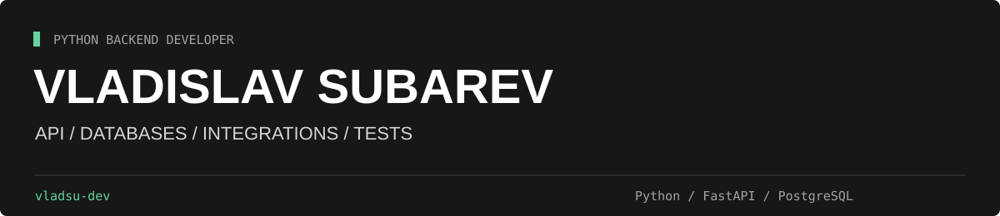

  

Пишу backend на Python: REST API, интеграции с внешними сервисами и работу с базами данных. В командных проектах занимаюсь серверной логикой, тестами и разбором замечаний к pull request.

Учусь в **ГУАП** на направлении "Информатика и вычислительная техника", а также на программе **«Профессия Python-разработчик» в Skillbox**. Ищу возможности развиваться в Python backend-разработке и работать над полезными продуктами в команде.

## С чем работаю

| Направление | Технологии |
| :--- | :--- |
| API и интеграции | Python, FastAPI, Pydantic, HTTPX, requests |
| Данные | PostgreSQL, SQLite, SQLAlchemy asyncio, Alembic |
| Проверка кода | pytest, pytest-asyncio, Ruff |
| Среда разработки | Git, Docker Compose, Poetry, Linux / macOS |

## Проекты

### [Авача: бэкенд для гонки на Камчатке](https://github.com/St3pAn1ndzy/kamchatka_race_back/tree/develop)

Командный проект хакатона Skillbox. Работал над публичным API, админкой и тестами. По ссылке выше открывается рабочая ветка `develop`.

**Мой вклад:**

- [Импорт маршрутов KML/GPX](https://github.com/St3pAn1ndzy/kamchatka_race_back/pull/63): предпросмотр, привязка трассы и контрольных пунктов к этапам.
- [Замена трассы во время этапа](https://github.com/St3pAn1ndzy/kamchatka_race_back/pull/64): сохранение GPS-истории и пересчёт прогресса участников.
- [Демонстрация движения трекера и SOS](https://github.com/St3pAn1ndzy/kamchatka_race_back/pull/66): отдельная демобаза и обновление карты и тревог без перезагрузки страницы.
- [Документация проекта](https://github.com/St3pAn1ndzy/kamchatka_race_back/pull/68): инструкции запуска и руководство для сотрудников по работе с админкой.

`FastAPI` · `PostgreSQL` · `SQLAlchemy` · `Alembic` · `Redis` · `pytest`

### МИРОНИКО · сайт логистической компании

Работал над сайтом с серверной и статической версиями на общих шаблонах. Тексты и контакты хранятся в JSON; отдельные Python-скрипты проверяют обязательные поля и собирают каталог для публикации.

`Python` · `FastAPI` · `Jinja2` · `HTML / CSS`

### [MovieBot · поиск фильмов в Telegram](https://github.com/vladsu-dev/moviebot)

Учебный проект с внешним API: поиск по названию и жанру, подборки фильмов, постраничная навигация и сохранение истории запросов в SQLite.

`pyTelegramBotAPI` · `requests` · `Peewee` · `SQLite`

## Что мне интересно в разработке

Понятные границы модулей, предсказуемые ошибки API и тесты, которые проверяют поведение приложения. Сейчас углубляюсь в асинхронный Python, транзакции и многозадачность.

За пределами Python

Экспериментирую с macOS-приложениями на Swift и SwiftUI. Один из проектов — прототип MacWinGameLauncher для управления профилями запуска Windows-приложений через Wine. Это исследовательский проект, совместимость с произвольными играми не заявляю.

---

**Санкт-Петербург · Python backend · открыт к junior-позициям и стажировкам**
