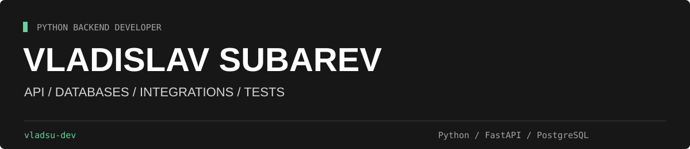

  

Разрабатываю серверные приложения на **FastAPI и Django**. Ищу junior-позицию или стажировку в Python backend. Живу в Санкт-Петербурге, рассматриваю удалённый и гибридный формат.

## Избранные проекты

### [«Авача» · сервис для организаторов гонки на Камчатке](https://github.com/St3pAn1ndzy/kamchatka_race_back/tree/develop)

В команде хакатона Skillbox разрабатывал API для зрителей и организаторов гонки. Реализовал справочники сезонов и дисциплин от моделей PostgreSQL и миграций до схем ответов и обработчиков FastAPI. В админке работал над назначением трекеров участникам и исправлением судейских отметок с записью изменений в журнал.

[Посмотреть код справочников в PR #34](https://github.com/St3pAn1ndzy/kamchatka_race_back/pull/34)

Мои задачи и pull requests по «Аваче»

- [Справочники гонки](https://github.com/St3pAn1ndzy/kamchatka_race_back/pull/34): модели сезонов и дисциплин в SQLAlchemy, связи этапов и участников, миграция Alembic, схемы Pydantic, репозитории, сервис и роуты FastAPI.
- [Публичное API](https://github.com/St3pAn1ndzy/kamchatka_race_back/pull/19): схемы ответов, запросы к базе и роуты для новостей, расписания и FAQ.
- Административные операции: [назначение трекеров участникам](https://github.com/St3pAn1ndzy/kamchatka_race_back/pull/40), [создание и корректировка судейских отметок](https://github.com/St3pAn1ndzy/kamchatka_race_back/pull/41), аудит изменений и обработка конфликтов при записи.
- Маршруты: [импорт KML/GPX с предпросмотром](https://github.com/St3pAn1ndzy/kamchatka_race_back/pull/63), [замена трассы](https://github.com/St3pAn1ndzy/kamchatka_race_back/pull/64) с сохранением GPS-истории и пересчётом прогресса.
- Подготовка к показу: [демосценарий трекера и SOS](https://github.com/St3pAn1ndzy/kamchatka_race_back/pull/66), [инструкции запуска и руководство по админке](https://github.com/St3pAn1ndzy/kamchatka_race_back/pull/68). Также работал над тестами API и сервисов на pytest.

### [Django CRM · от первого обращения до договора](https://github.com/vladsu-dev/django-crm)

В учебной CRM оператор регистрирует обращение, менеджер оформляет договор, а маркетолог видит, какие кампании привели клиентов. Реализовал разграничение прав, загрузку и скачивание договоров и отчёт по конверсиям и суммам сделок.

**Django · PostgreSQL · Docker Compose · pytest**

### [File Sync · зеркало локальной папки на Яндекс Диске](https://github.com/vladsu-dev/yandex-disk-file-sync)

Написал CLI и клиент REST API. Утилита сравнивает файлы по хешам и загружает изменения. Если сверка или загрузка завершилась ошибкой, утилита откладывает перенос лишних облачных файлов в корзину до успешного прохода.

## Другие проекты

- **«Миронико»**. Для сайта логистической компании сделал предпросмотр на FastAPI и статическую сборку из общих шаблонов Jinja2. Тексты и контакты можно менять в JSON.
- **MovieBot**. Telegram-бот ищет фильмы через внешний API, показывает подборки и сохраняет историю запросов каждого чата в SQLite. [Код бота](https://github.com/vladsu-dev/moviebot)

## Образование

Учусь в ГУАП на направлении «Информатика и вычислительная техника» и на программе «Профессия Python-разработчик» в Skillbox.
